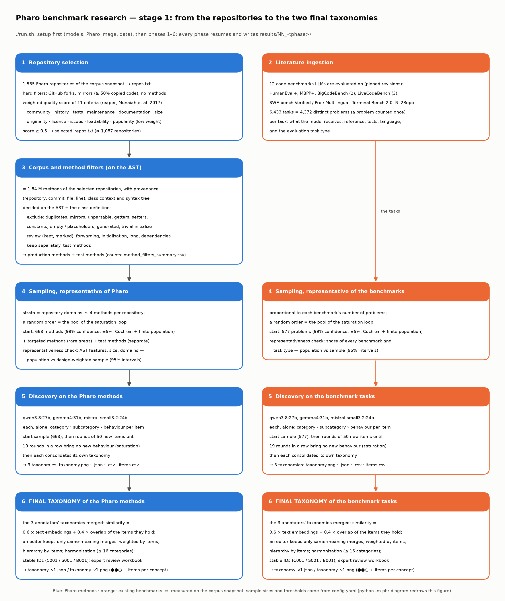

# Methodology

This document describes, in full detail, how the study is carried out: the research questions, the design
principles, every phase of the pipeline (what goes in, what happens, with which settings and why, what comes out),
the models and how they are queried, the statistics, how a run is reproduced, and the threats to validity.
Every number given here comes from `config.yaml` (profile `full` unless stated) or from the code in `pbr/`.



*Stage 1. Blue: the Pharo side. Orange: the existing benchmarks. The two sides are processed the same way and meet
only at the end, as two comparable taxonomies.*

---

## 1. Research questions

- **RQ1 — What does Pharo code do?** Which programming behaviours do real, engineered Pharo methods exhibit, and
  how often does each one occur?
- **RQ2 — What do the benchmarks test?** Which programming behaviours do the tasks of the code benchmarks that LLMs
  are evaluated on actually exercise?
- **RQ3 — The gap.** Which behaviours that matter in Pharo are not tested by the existing benchmarks, and the
  reverse?
- **RQ4 — How well do LLMs handle the Pharo behaviours?** On a new, validated, executable Pharo benchmark built
  from the behaviours of RQ1–RQ3, how often do models produce correct code, per behaviour, category and task type?

**Unit of analysis.** A *programming behaviour*: what a piece of code does, described in language-neutral words
(e.g. "select the elements of a collection that satisfy a predicate"), organised in three levels:
**category › subcategory › behaviour**. The *evaluation task type* (code generation, completion, bug repair, …) is
a property of how a benchmark asks the question, not a behaviour, and is recorded separately.

---

## 2. Design principles

1. **No list of behaviours is imposed in advance.** The taxonomies are discovered from the data (inductive coding),
   then consolidated, then validated (TnT-LLM: generate, then consolidate; Wan et al. 2024).
2. **Three independent annotators of three model families.** Related models make correlated mistakes (Kim et al.
   2025). qwen (Alibaba), gemma (Google) and mistral (Mistral AI) each work alone and never see another model's
   answers. Agreement between them is measured, not assumed.
3. **The two sources are processed identically.** Pharo methods and benchmark tasks go through the same sampling
   logic, the same discovery procedure and the same merging, so that the two taxonomies are comparable.
4. **No item is used both to build and to judge.** Disjoint samples are drawn with the same design: one builds the
   taxonomy (discovery), one validates it (annotation), one measures frequencies (profile).
5. **Representative samples with known precision.** 99 % confidence, ±5 % margin; a stratified two-stage design so
   that a few huge repositories cannot dominate; design weights for every estimate.
6. **Non-observation is never read as absence.** Every gap carries its sample size and the upper bound of the share
   the sample still allows (rule of three).
7. **AI majority is never taken as truth.** Blinded human experts are the reference; AI agreement is a reliability
   measure only.
8. **Independent oracles for the benchmark.** The model that writes a task's reference and tests is never the one
   that writes the behaviour contract or the independent tests that check it.
9. **Everything is reproducible and traceable.** Pinned sources, temperature 0 with a fixed seed, every raw model
   answer cached with the model's digest, a fingerprint per phase, provenance (repository, commit, file, line, link)
   for every Pharo method.

---

## 3. The pipeline at a glance

```
 STAGE 1 — two taxonomies                               STAGE 2 — validate, compare, build, evaluate
 ───────────────────────────────────────                ───────────────────────────────────────────────
  0 setup          models, Pharo image, benchmarks, corpus
  1 repositories   1,585 → ≈ 1,087 selected               7 annotation     new samples, 3 annotators, alone
  2 literature     12 benchmarks → 4,372 problems         8 validation     agreement (α) + blinded experts
  3 corpus         ≈ 1.84 M methods, AST filters          9 profile        how often each behaviour occurs
  4 sampling       99 % ±5 % samples + pools             10 coverage       Pharo × benchmarks, per behaviour
  5 discovery      3 models × 2 sources, saturation      11 benchmark      contracts → new Pharo tasks
  6 taxonomy       merged → 2 final taxonomies           12 verification   5-level validation of each task
                                                         13 evaluation     models × task variants
```

| # | Phase | What goes in | What comes out | Humans |
|---|---|---|---|---|
| 0 | Setup | `config.yaml` | models, Pharo image, benchmarks, corpus in `data/` | |
| 1 | Repository selection | 1,585 mined repositories | ≈ 1,087 engineered projects (weighted quality score ≥ 0.50) | |
| 2 | Literature ingestion | 12 benchmarks at pinned revisions | 6,433 tasks = 4,372 distinct problems, with their task type | |
| 3 | Corpus and method filters | ≈ 1.84 M methods | a decision per method, taken on its syntax tree | |
| 4 | Representative samples | eligible methods, problems | 99 % ±5 % start samples (663 + 577), ordered pools, disjoint splits | |
| 5 | Discovery | the discovery samples | 6 taxonomies (3 annotators × 2 sources), each until saturation | |
| 6 | Final taxonomies | the 6 taxonomies | 2 final taxonomies with stable IDs (C / S / B) | review |
| 7 | Annotation | NEW samples + a taxonomy | 3 independent classifications of every item | |
| 8 | Validation | the classifications | agreement (α, κ, AC1); expert labels; `taxonomy_v2` | experts |
| 9 | Profile | a large random sample | design-weighted frequency of every behaviour in Pharo | |
| 10 | Coverage | phases 7–9 | per behaviour: both · Pharo only · literature only · investigate | |
| 11 | Benchmark construction | selected behaviours, Pharo seeds | behaviour contracts; tasks that execute in the image | selection |
| 12 | Benchmark validation | the tasks | verified / quarantined / rejected tasks, 3 variants each | audit |
| 13 | Evaluation | verified tasks, the models | pass rates per model × category × task type | |

Stage 2 works with **one** of the two final taxonomies, `taxonomy.stage2_source` (default: the Pharo taxonomy). It
classifies both the Pharo methods and the benchmark tasks with it, so phase 10 compares the two sources on the same
behaviour IDs; behaviours found only in the benchmarks appear there as UNKNOWN.

---

## 4. Models and how they are queried

### 4.1 Roles

All models run locally through Ollama.

| Role | Phase | Model |
|---|---|---|
| annotators (3 families, never shown each other's answers) | 5, 7, 9 | `qwen3.8:27b` (Alibaba) · `gemma4:31b` (Google) · `mistral-small3.2:24b` (Mistral AI) |
| taxonomy editor (judges merges, writes definitions) | 6 | `qwen3.8:27b` |
| concept similarity (embeddings, 768 dimensions) | 5, 6 | `nomic-embed-text` |
| task author (reference, tests, statement) | 11 | `qwen3.8:27b` |
| behaviour contracts | 11 | `gemma4:31b` |
| independent tests (oracles) | 12 | `gemma4:31b` · `mistral-small3.2:24b` |
| evaluated models | 13 | `qwen3.8:27b` · `gemma4:31b` · `mistral-small3.2:24b`, plus the reference solutions (must score 100 %) |

The contract and oracle models are of other families than the task author, so they cannot share its
misunderstandings. The three evaluated models also helped build the benchmark; this is reported with the results
(§9).

### 4.2 Decoding and structured output (`pbr/llm.py`)

- **Temperature 0 and a fixed seed** (`project.seed: 42`) for every call.
- **Structured output.** Every answer must follow a JSON schema given to the model (Ollama `format`). Where the
  answer is a choice among known identifiers (taxonomy IDs, proposal groups, subcategories), the schema lists them
  as an enumeration, so the model cannot invent one. The parsed answer is validated again in Python; an invalid
  answer is retried.
- **Retries.** Up to `llm.max_retries: 4` retries for transport errors and invalid structured output. An answer
  cut at its token limit (`done_reason = length`) is *not* retried with the same budget: it would be cut again.
- **Context window.** `llm.num_ctx: 16384` tokens by default. Before each call, the prompt size is estimated
  (≈ 3 characters per token, plus the answer budget and a margin of 2,200 tokens). When it does not fit, the window is
  doubled (and kept for later calls) up to `llm.max_num_ctx: 65536`. A call that still does not fit is an error:
  Ollama would otherwise silently truncate the prompt, so a prompt is never cut.
- **Streaming.** Ollama answers are streamed; `llm.timeout_seconds: 600` is the longest silence allowed, not the
  total time, so a long answer from a slow model is never cut by a timeout.
- **Cache.** Every raw answer (every attempt included) is stored in `data/llm-cache/`, keyed by a hash of the full
  request (model, prompt, schema, decoding parameters, prompt version). A cached answer made by another build of the
  model (another digest) is a miss and is asked again. A rerun therefore never asks the same question twice, and an
  interrupted phase resumes item by item.
- **Ledger.** Every call is logged in `results/logs/llm_calls.jsonl` (phase, model, tokens in and out, latency,
  cache hit). `./run.sh cost` gives calls, tokens, time and the cost the same calls would have on a hosted API
  (`llm.reference_price`).
- **Prompt versions.** Every prompt carries a version string (e.g. `discovery-v1`, `discovery-consolidate-v3`)
  recorded with the answer, so a result can always be traced to the exact prompt that produced it.

### 4.3 Parallelism (speed only)

`config.yaml → compute` sets how many requests are in flight per model (`llm_parallel`) and how many annotators work
at the same time (`models_parallel`); the environment variables `LLM_PARALLEL` and `MODELS_PARALLEL` override them.
Parallel calls are order-preserving and use the same cache keys, so **a parallel run gives exactly the same results
as a serial one**; this section is not part of any phase fingerprint. On one H100 or H200: `LLM_PARALLEL=8
MODELS_PARALLEL=3`, with Ollama started with `OLLAMA_NUM_PARALLEL=8` and `OLLAMA_MAX_LOADED_MODELS=3` (the three
annotators fit together in 80 GB: ≈ 56 GB measured).

---

## 5. Step 0 — Setup

Before the first phase, `./run.sh` obtains every dependency and stops with the reason if one cannot be obtained
(`pbr/setup.py`, log `results/logs/00_setup.log`).

| Dependency | What setup does |
|---|---|
| the four Ollama models | `ollama pull` when missing; checks that the files are complete (`/api/show`) |
| the Pharo 13 validation image (+ MuTalk v3.0.8, PharoBench-Support), its VM and the list of its global names | built or copied into `data/pharo-image/`; on the first build, the VM must evaluate `3 + 4` |
| the 12 benchmarks | downloaded at pinned revisions into `data/existing-benchmarks/`, each one loaded |
| the Pharo corpus | the parsed methods of the Hugging Face snapshot `pharo-llm/pharo-labels`, revision `snapshot-20261010-182354` (1.3 GB), into `data/pharo-corpus/` |

Setup checks that the dependencies are **present**, not that they **work**: no model is asked a question, and an
existing image is not run again. A broken model or image shows up in the first phase that uses it.

---

# Stage 1 — two taxonomies (phases 1–6)

## Phase 1 — Repository selection (`pbr/phases/repositories.py`)

**Goal.** Study engineered Pharo projects, not toy, personal or copied repositories.

**Input.** The 1,585 repositories of the corpus snapshot. They passed the first mining filter of the earlier
labelling study: real Pharo source code (Tonel / FileTree), not coursework, some history.

**Procedure.**

1. **Hard filters**, which no score can compensate (`repositories.hard_filters`):
   - GitHub forks (most forks are copies; Kalliamvakou et al. 2014);
   - *mirrors*: repositories whose non-trivial methods are mostly (≥ 50 %) copies of an older repository;
   - repositories without any parsed method.
2. **A quality score** in [0, 1] for each remaining repository, after the *reaper* framework for identifying
   engineered software projects (Munaiah et al. 2017): eleven criteria, each turned into a score in [0, 1], then a
   weighted sum (the weights sum to 1).

   | criterion | measure | transform, cap | weight | reason |
   |---|---|---|---|---|
   | community | contributors | log, 10 | 0.15 | most GitHub repositories are personal |
   | history | commits | log, 500 | 0.15 | most repositories have very few commits |
   | unit testing | share of test methods | ratio, 0.30 | 0.15 | reaper "unit testing" |
   | maintenance | development span × recency of the last push | ratio, 1.0 | 0.10 | most repositories are inactive |
   | documentation | share of classes with a class comment | ratio, 0.50 | 0.10 | reaper "documentation" |
   | size | non-test methods | log, 2,000 | 0.10 | toy projects exhibit few behaviours |
   | originality | 1 − share of non-trivial methods copied from an older repository | ratio, 1.0 | 0.05 | duplication on GitHub (Lopes et al. 2017) |
   | licence | a licence is declared | ratio, 1.0 | 0.05 | redistribution of the derived benchmark |
   | issues | open issues (the tracker is used) | log, 20 | 0.05 | reaper "issues" |
   | loadability | a Metacello `BaselineOf` class | ratio, 1.0 | 0.05 | the project can be loaded, tested, executed |
   | popularity | stars + forks | log, 50 | 0.05 | deliberately small: stars measure popularity, not quality (Borges & Valente 2018) |

   Transforms: `log`: min(1, log(1 + x) / log(1 + cap)), diminishing returns; `ratio`: min(1, x / cap). So no huge
   repository can dominate and no criterion can exceed its weight. Maintenance = span score × recency score: a
   development span (creation → last push) of 2 years earns the full span score; a last push within 2 years of the
   snapshot earns full recency, decreasing linearly to 0 at 8 years.
3. **Threshold.** A repository is selected when its score is ≥ **0.50**, half of the maximum. The sensitivity of
   this choice is drawn in `threshold_sensitivity.png`.

The score only decides which repositories are studied. It is **never** used later as a measure of importance or as
a sampling weight.

**Output** (`results/01_repositories/`): `repos.txt`, `repository_scores.csv` (raw measures, criterion scores,
score, hard filters, decision and reason), `selected_repos.txt` (≈ 1,087), `scoring_scheme.md`,
`repo_metrics.parquet`, figures (score distribution, threshold sensitivity, criteria kept vs excluded, score
contributions, popularity vs score, decisions).

---

## Phase 2 — Literature ingestion (`pbr/phases/literature.py`, `pbr/benchmarks.py`)

**Goal.** Know exactly what the existing benchmarks ask a model to do.

**Input.** The code benchmarks frontier models are evaluated on, at pinned revisions:

| Benchmark | Evaluation task type | Granularity | How answers are checked |
|---|---|---|---|
| HumanEval+ | code completion | function | hidden unit tests (EvalPlus) |
| MBPP+ | code generation | function | hidden unit tests (EvalPlus) |
| BigCodeBench-Complete | code completion | function | unit tests |
| BigCodeBench-Instruct | code generation | function | unit tests |
| LiveCodeBench code generation | code generation | program | hidden input/output tests |
| LiveCodeBench test-output prediction | test generation | function | exact match |
| LiveCodeBench code execution | other (execution prediction) | function | exact match |
| SWE-bench Verified | bug repair (issue resolution) | repository | fail-to-pass / pass-to-pass tests |
| SWE-bench Pro | bug repair (issue resolution) | repository | fail-to-pass / pass-to-pass tests |
| SWE-bench Multilingual | bug repair (issue resolution) | repository | fail-to-pass / pass-to-pass tests |
| Terminal-Bench 2.0 | other (agentic terminal task) | environment | test script on the final container state |
| NL2Repo | code generation (repository generation) | repository | the library's own test suite |
| DeepSWE | bug repair (issue resolution) | repository | task tests — gated on Hugging Face: included only when a token with access is available |

**Procedure.** Every task is read and recorded with: its source (benchmark, dataset, revision, paper), what the
evaluated model receives, the reference answer, how the answer is checked, its programming language, and the
evaluation task type. The task type is a property of how a benchmark is built, so it is set once in
`config.yaml → literature.task_types` with its reason, never guessed by a model. Overlapping benchmarks
(SWE-bench Verified ⊂ SWE-bench; BigCodeBench-Instruct = Complete reworded; the LiveCodeBench scenarios reuse the
same problems) are kept in the tables, but a problem is counted **once** for behaviours (deduplication key).
`task_uid = "<benchmark>::<item id>"` is stable.

**Output** (`results/02_literature/`): `literature_tasks.parquet` (6,433 tasks = 4,372 distinct problems),
`literature_benchmarks.csv`, figures (tasks per benchmark, task types, languages).

---

## Phase 3 — Corpus and method filters (`pbr/phases/corpus.py`, `pbr/method_filters.py`)

**Goal.** Keep the methods that carry real behaviour, and know why every other method is left out.

**Input.** Every method of the selected repositories (≈ 1.84 M), read from the parsed files of the snapshot.

**Procedure.**

1. **Provenance and stable IDs.** Every method keeps repository, commit, file, line, class, side, selector and a
   permalink `https://github.com/<repo>/blob/<commit>/<file>#L<line>`. `method_id` is a hash of (repository, file,
   class, side, selector): independent of the line, of the parse order and of the run.
2. **Context.** Package, protocol, superclass, instance variables, class comment; structure: size, message sends,
   sent selectors, referenced globals, pragmas, and the parser's features (loops, conditionals, exception handling,
   reflection, …).
3. **Copies.** Exact duplicates (same source) and normalised duplicates (same code once comments and layout are
   removed) are found across repositories. The copy in the **oldest** repository is the original. Trivial methods
   (one statement) are flagged separately: their repetition is an idiom, not copying.
4. **A decision for every method, taken on its syntax tree and its class definition.** Names are resolved as the
   Pharo compiler does: arguments and temporaries, then the variables of the class, then `self`, `super`, `true`,
   `false`, `nil`, then globals (the global names of the Pharo 13 image). A getter, for instance, is a method whose
   only statement returns one of its class's instance variables, not a method whose text looks like one.

   | method | decision |
   |---|---|
   | a copy of an older method · in a mirror repository · cannot be parsed | exclude |
   | simple getter `^ v` · simple setter `v := arg` (v a variable of its class) | exclude |
   | returns a constant (`^ 42`, `^ 'text'`, `^ true`, a literal array) | exclude |
   | empty · placeholder (`self subclassResponsibility`, `^ self`, `self error: 'not implemented'`) | exclude |
   | generated (package manifests, Metacello baselines, `<generated>`, embedded data) | exclude |
   | trivial `initialize` (`super initialize` and `v := literal` / `v := Class new` only) | exclude |
   | simple forwarding · other initialisation · long (> 60 lines or > 40 statements) · uses classes neither its project nor Pharo defines | review: kept, marked with the reason |
   | test methods | kept separately (`keep_test`) |
   | everything else | keep |

   Methods longer than 6,000 characters are kept but flagged (generated code, image dumps). With
   `method_filters.include_review: true`, review methods are eligible for sampling, marked with their reasons.

**Output** (`results/03_corpus/`): `repositories.parquet`, `methods.parquet`, `method_filters.parquet` (decision
and every reason of every method), `method_filters_summary.csv`, `duplicates.parquet`, figures (methods per
repository, repository groups, duplication, method size, features).

---

## Phase 4 — Representative samples (`pbr/phases/sampling.py`)

**Goal.** Samples that really represent Pharo code and the benchmarks, large enough for 99 % confidence, and
disjoint between the uses.

### 4.1 Two kinds of samples, never mixed in an estimate

- **Random (probability) samples**, to estimate how frequent a behaviour is. Stratified two-stage cluster design:
  - *strata* = repository groups by application domain (`sampling.group_by: domain`); domains with fewer than 8
    repositories are pooled into "other"; every group gets the same number of repositories (`allocation: equal`),
    so every domain is equally visible;
  - *stage 1*: repositories drawn at random inside each group;
  - *stage 2*: at most `methods_per_repo` methods drawn at random inside each drawn repository (4 for the discovery
    pool, 2 for the other splits), so a large repository cannot dominate.

  Every method carries its inclusion probability and its **design weight**
  `w = (N_h / n_h) × (M_i / m_i)`, with N_h eligible repositories in group h, n_h drawn, M_i eligible methods in
  repository i, m_i drawn (Cochran 1977, ch. 10–11).
- **Targeted samples**, to discover rare behaviours: methods that send selectors or reference globals of rare
  areas. They have **no weight** and are excluded from every frequency.

  | area | signals |
  |---|---|
  | exceptions | `on:do:`, `ensure:`, `ifCurtailed:`, `signal:`, `retry`, `pass` |
  | concurrency | `fork`, `forkAt:`, `critical:`, `wait`, `signal`, `newProcess` |
  | streams | `readStream`, `writeStream`, `nextPutAll:`, `upToEnd`, `contents` |
  | reflection | `perform:`, `perform:with:`, `respondsTo:`, `instVarNamed:`, `compile:`, `methodDict` |
  | FFI | `ffiCall:`, `ffiCall:module:` |
  | files | `asFileReference`, `readStreamDo:`, `writeStreamDo:`, `ensureCreateDirectory` |
  | network | `ZnClient`, `ZnServer`, `Socket`, `ZnUrl` |
  | serialisation | `STON`, `NeoJSONReader`, `NeoJSONWriter`, `FLSerializer` |
  | UI | `SpPresenter`, `SpApplication`, `BlElement`, `Morph` |
  | database | `SQLite3Connection`, `VOMongoRepository`, `GlorpSession` |
  | parsing | `PP2Node`, `PPParser`, `RBParser` |

- **Test methods** form a separate pool, sampled with the same design at their own sizes.

### 4.2 Three disjoint splits

| Split | Used by | Pharo methods (profile `full`) | Benchmark problems |
|---|---|---|---|
| `discovery` | phase 5: build the taxonomies | 99 % ±5 % start sample (663) + saturation pool; + 60 targeted + 60 test methods | 99 % ±5 % start sample (577) + saturation pool, stratified by benchmark |
| `annotation` | phases 7–8: validate the taxonomy | 384 random (95 % ±5 %) + 60 targeted + 60 test methods | 30 per benchmark |
| `profile` | phase 9: frequencies | 3,000 random production methods | — |

Benchmark problems are stratified by benchmark (each contributes in proportion to its number of problems), one
problem counted once.

### 4.3 Sample size

Cochran's formula with the finite population correction, at the most conservative proportion p = 0.5:

```
n0 = z² · p(1 − p) / e²          z = 2.576 (99 %), e = 0.05   →  n0 = 663.6
n  = n0 / (1 + (n0 − 1) / N)
```

≈ 690,000 eligible Pharo methods → **663**; 4,372 benchmark problems → **577**. (100 % confidence would mean a
census of every item.)

Each discovery sample is an **ordered pool**: the start sample, then the items the saturation loop of phase 5 will
add, in order, drawn with the same design: start + `max_rounds` (30) × `round_size` (50) items at most.

### 4.4 Representativeness check

The start sample of Pharo methods is compared with the whole population on what their syntax trees show (loops,
conditionals, iteration, exception handling, blocks, reflection, recursion, method size), each with a 95 %
interval; for the benchmarks, the share of every benchmark and task type.

**Output** (`results/04_sampling/`): `sampling_design.json` (frame, eligibility rules and counts, groups,
allocation, formulas, seeds), `pilot_sample.csv` (every sampled method: split, purpose, group, probabilities,
weight, provenance), `literature_sample.csv`, `representativeness.csv`, figures.

---

## Phase 5 — Discovery until saturation (`pbr/phases/discovery.py`)

**Goal.** Find every behaviour that occurs, without imposing a list of categories in advance.

**Who.** The three annotators, each alone, each building **two** taxonomies, one per source: six in all.

### 5.1 Open proposals

Items are shown in batches of 6 (`discovery.batch_size`; every model sees the same batches). For each item, the
annotator proposes up to 3 behaviours (`max_behaviors_per_item`), each at three levels — **category › subcategory
› behaviour** — in language-neutral words (so that a Python task and a Pharo method can be compared), with a quote
of the item as **evidence**. A Pharo method is shown with its class context; a benchmark task with what the
evaluated model receives. The evaluation task type is explicitly not a behaviour.

### 5.2 Saturation loop

1. The annotator first reads the **99 % start sample** (§4.3), plus the targeted and test methods.
2. It then goes on with rounds of **50 new items** from the same ordered pool.
3. After each round, every proposal is embedded (`nomic-embed-text`, text "category › subcategory › behaviour") and
   compared with everything this annotator proposed before. Proposals with cosine ≥ **0.85**
   (`novelty_threshold`) form a group; a group that reaches **2 items** (`min_support`) is a behaviour. A round is
   *new* when a behaviour appears; one odd wording alone never counts as new.
4. **Saturation**: the annotator stops when `patience` rounds in a row bring no new behaviour. The patience is
   derived from `min_share = 0.005`: the smallest k such that a behaviour present in 0.5 % of the items would have
   appeared with 99 % probability,

   ```
   (1 − 0.005)^(k · 50) ≤ 1 − 0.99   →   k = ⌈ ln(0.01) / ln(0.995) / 50 ⌉ = ⌈ 918.7 / 50 ⌉ = 19 rounds
   ```

   with a safety cap of 30 rounds (`max_rounds`). Each annotator saturates on its own.

### 5.3 Consolidation into one taxonomy per annotator and source

Each annotator then organises **its own** proposals into a taxonomy, with a definition for every concept and
inclusion and exclusion rules. The work is split so that every call stays small, whatever the number of proposals
(thousands), and nothing is truncated:

1. **Grouping.** Identical and near-identical proposals (embedding cosine ≥ 0.85) are grouped; each group keeps
   its wordings and the items it covers. Groups are ordered by the number of items they cover.
2. **Skeleton.** The annotator sees its most frequent groups (up to ≈ 20,000 characters, ≈ 6,000 tokens,
   `consolidation.overview_chars`) and designs the categories and subcategories, each with a definition: at most
   **16 categories** and **8 subcategories per category**.
3. **Routing.** Every group is placed in exactly one subcategory, or in none, in batches of 80 groups; the answer
   is constrained to the existing subcategory IDs.
4. **Behaviours, one subcategory per call.** For each subcategory, the annotator sees its definition, its sibling
   subcategories and the groups routed to it (up to 120 at once), and writes at most **10 behaviours**: name,
   definition, 1–3 inclusion rules, 1–3 exclusion rules, and the groups each behaviour covers. Groups not covered in
   that call are then placed among the behaviours of their subcategory, in batches.
5. **Cleaning.** Behaviours with no proposal, and subcategories or categories left empty, are removed. **Nothing is
   dropped silently:** groups placed nowhere are kept in the taxonomy as *unassigned proposals*, and the share of
   proposals placed (`assigned_share`) is recorded (≈ 99 % on the real run checked during development).

The caps (16 / 8 / 10) keep each taxonomy readable and each call within the model's context; the final shape is
decided in phase 6, where the three annotators' taxonomies are merged.

**Output** (`results/05_discovery/<annotator>/<pharo|literature>/`): `taxonomy.png`, `taxonomy.json` (hierarchy,
definitions, rules, items, evidence, unassigned proposals), `taxonomy.csv` (one row per behaviour), `items.csv`
(every item with the behaviours this annotator gave it), `saturation.csv` / `saturation.png`, `proposals.jsonl`,
`raw_responses.jsonl`; and `discovery_summary.csv`, `saturation_curves.csv`, comparison figures.

---

## Phase 6 — The two final taxonomies (`pbr/phases/taxonomy.py`, `pbr/taxonomy.py`)

**Goal.** One taxonomy per source that the three annotators support, with stable identifiers.

For the Pharo methods and, separately, for the benchmark tasks:

1. **Flatten** the three taxonomies into concepts (model, level, name, definition, rules, items, parent).
2. **Similarity of two concepts**, per level (category, subcategory, behaviour), from two pieces of evidence:
   - **their meaning**: cosine of the embeddings of "name: definition";
   - **their items**: the three annotators classified the *same* items, so two concepts that hold the same items
     very likely mean the same thing even with different words, and two concepts with similar words but different
     items very likely do not. Jaccard overlap on the items both annotators saw; a category or subcategory holds
     every item under it.

   **similarity = 0.6 × cosine + 0.4 × Jaccard** (`taxonomy.similarity_weights`).
3. **Candidate groups.** Average-linkage clustering at a threshold per level (category 0.44, subcategory 0.46,
   behaviour 0.47 on the combined similarity: ≈ cosine 0.78 with no shared item, or cosine 0.5 with half of the
   items shared). Groups larger than 9 members are re-split with a stricter threshold. These groups are only
   *candidates*: embeddings alone rate "iterate" and "filter" closer than two wordings of "filter".
4. **Judged merges.** The editor model (qwen) reads each candidate group — every member with the number of items it
   holds, the largest first — and partitions it into concepts whose members mean the same thing, writing one name,
   definition, inclusion and exclusion rules per concept, after the members that hold most items. A single
   proposal keeps its model's text. Groups the editor splits are listed for review (`merge_candidates.csv`):
   matching names alone are never enough.
5. **One tree, weighted by items.** A behaviour goes under the subcategory where most of its members' **items**
   were placed (not most of its members); a subcategory under the category where most of its items were. The
   editor then merges categories down to at most **16** (it sees how many items each holds) and harmonises
   duplicate subcategories and behaviours. Every operation is recorded.
6. **Stable identifiers**: `C001…` categories, `S001…` subcategories, `B001…` behaviours, remembered in
   `results/taxonomy_registry.json`, so a rerun or a new version gives the same concept the same ID. Each concept
   keeps its definition, rules, aliases (the annotators' wordings), the annotators that proposed it (a behaviour
   proposed by fewer than `min_models_for_behavior` models is kept but marked), and its items.
7. **Expert review.** `review/taxonomy_review.xlsx` lets an expert accept, rename, redefine, merge, split, reject,
   add or move any concept. Completed files in `review/returned/` are applied at the next run. Without them, v1 is
   the unreviewed draft and the phase is *provisional* (`taxonomy.require_review: true` stops instead).

**Reading a taxonomy figure.** A box is a category; grey bold lines are its subcategories; the other lines are its
behaviours with their ID. **●●○** before a behaviour: one ● per annotator whose concept was merged into it (●●● =
the three found it). Under it, a bar and a number: how many items were classified under that behaviour; on the
right of a category or subcategory, the same for everything inside it. Bars are scaled per level.

**Output** (`results/06_taxonomy/<source>/`): `taxonomy_v0_draft.json`, `taxonomy_v1.json`,
`taxonomy_aliases.csv`, `merge_candidates.csv`, `annotation_guidelines_v1.md`, `review/taxonomy_review.xlsx`,
figures (`taxonomy_v1.png`, model overlap, support per behaviour).

---

# Stage 2 — validate, compare, build, evaluate (phases 7–13)

Stage 2 uses the final taxonomy of `taxonomy.stage2_source` (default `pharo`) for both sources, and only items the
taxonomy was not built from (§4.2).

## Phase 7 — Independent annotation (`pbr/phases/annotation.py`)

**Goal.** Know whether the taxonomy can be applied consistently to items it was not built from.

**Procedure.** Each annotator, alone, classifies every item of the `annotation` split, one item per request, with
the same prompt for every model. A Pharo method is shown with its class context (superclass, instance variables,
class comment; `annotation.context: class`). The answer gives **1 to 3 behaviour IDs**, constrained by the schema
to the taxonomy's IDs plus `UNKNOWN` (no behaviour fits) and `INSUFFICIENT` (not enough context), each with evidence
quoted from the item and a confidence, plus an explanation and an uncertainty level. Whether the quoted evidence
really occurs in the item is checked.

**Output** (`results/07_annotation/`): `annotations_raw.jsonl` (every answer, valid or not), and
`annotations_validated.parquet` (one row per item and model: IDs, evidence and whether it occurs, model digest,
taxonomy version, prompt version, request hash, tokens, latency, attempts), figures.

## Phase 8 — Agreement and expert validation (`pbr/phases/validation.py`, `pbr/agreement.py`, `pbr/workbook.py`)

**Goal.** Measure how reliable the classifications are, against each other and against people.

1. **AI agreement**, per item: full, partial or no agreement, or insufficient / unknown (at least two models say so).
   Krippendorff's α with the MASI distance on behaviour sets (multi-label) and nominal on the primary behaviour and
   on the category; Fleiss' κ; Gwet's AC1 (robust to skewed prevalence); pairwise Cohen's κ; α per behaviour
   (present / absent). α ≥ 0.667 is the usual lower bound for tentative conclusions (Krippendorff 2004).
2. **Blinded expert workbook** (`expert/expert_workbook.xlsx`): 200 items (`full`), stratified by AI agreement —
   25 % full, 40 % partial, 35 % none — so that more items come from where the models disagree; stratum sizes are
   kept for stratified estimators. The code or task and the taxonomy definitions are shown; **the AI answers are
   not**. Sheets: Method Annotation, Taxonomy (reference), Taxonomy Review, Behaviour Relevance.
3. **Import** of completed workbooks (`expert/returned/*.xlsx`): validated (known rows, existing IDs, reviewer
   identity), every decision kept with its reviewer, file and sha256. Then: the experts' agreement among themselves
   (the human baseline); reference labels; humans versus AI — precision, recall, F1, exact match, accuracy of the
   primary behaviour and category, overall, stratified, and per AI agreement level. AI majority is never taken as
   correctness.
4. **Adjudication**: items where experts disagree among themselves or with the AI majority go to
   `adjudication/adjudication.xlsx`, now with the AI answers revealed; returned decisions override.
5. **Corrected taxonomy**: the experts' Taxonomy Review decisions produce `taxonomy_v2.json`, with the map v1 → v2
   (v1 annotations stay as they are).

Without returned workbooks, the phase computes AI agreement only and is *provisional*.

## Phase 9 — How often each behaviour occurs in Pharo (`pbr/phases/profile.py`)

**Goal.** Estimate the frequency of every behaviour in real Pharo code, with honest intervals.

**Procedure.** The `profile` split (3,000 random production methods) is classified with the latest taxonomy (v2 if
the experts corrected v1, else v1) by the profile model: with `profile.models: auto`, the annotator closest to the
experts (micro F1, phase 8), or, without expert labels, the one agreeing most with the other two (mean pairwise
κ). Reported per behaviour, subcategory and category:

- methods in the sample and unweighted share;
- the **design-weighted share** with a 95 % interval: ratio estimator, linearisation variance, repositories as
  primary sampling units within groups;
- **repository prevalence**: share of sampled repositories where the behaviour appears (a lower bound: only a few
  methods per repository are sampled);
- **differences across repository groups**: weighted shares per group, χ² test of independence on counts (an
  approximation that ignores the clustering);
- **rare** behaviours (weighted share < 1 %, `profile.rare_share`) and **important** ones (expert relevance ≥ 4);
- **unknown and uncertain** classifications and the missing behaviours the models described;
- with expert labels, category shares **corrected for the model's errors** by prediction-powered inference
  (Angelopoulos et al. 2023), expert items weighted by their stratum weight.

**Output** (`results/09_profile/`): `pharo_behavior_profiles.parquet`, `weighted_frequency.csv`,
`repository_prevalence.csv`, `group_differences.csv`, `unknowns.csv`, figures.

## Phase 10 — Pharo versus the benchmarks (`pbr/phases/coverage.py`)

**Goal.** For each behaviour, say whether the existing benchmarks test what Pharo code does.

**Procedure.** The two classified datasets are joined on the behaviour IDs.

- *Benchmark side*: the literature items of phase 7, labelled by the AI majority (behaviours given by at least two
  of the three annotators), replaced by the human reference where phase 8 has one. Share = tasks with the behaviour
  / tasks; also in how many benchmarks.
- *Pharo side*: the design-weighted share of phase 9 with its interval, and the Pharo items of phase 7 (random
  design, AI majority) as a second, independent sample.

Status of every behaviour:

| Status | Rule |
|---|---|
| `both` | observed on both sides with at least 2 items each (`coverage.min_support`) |
| `pharo_only` | observed in Pharo, **not identified** in the benchmark sample |
| `literature_only` | observed in the benchmarks, **not observed** in the sampled Pharo corpus |
| `investigate` | too little support on a side, annotators disagree on it (α < 0.667), or observed nowhere |

Non-observation is never read as absence: every gap carries its sample size n and the upper bound of its share
that the sample still allows, `1 − 0.05^(1/n)` ≈ 3/n (rule of three, 95 %). Every row keeps example items (IDs and
links) from each side as evidence.

**Output** (`results/10_coverage/`): `coverage_matrix.csv`, `behavior_gaps.csv`, `coverage_by_benchmark.csv`,
figures.

## Phase 11 — Benchmark construction (`pbr/phases/benchmark.py`, `pbr/oracle.py`)

**Goal.** New, self-contained Pharo tasks for the behaviours the benchmarks miss or that Pharo needs most.

1. **Behaviours to cover.** `selected_behaviors.csv` when the research team wrote one; otherwise chosen from the
   coverage matrix: `pharo_only` first, then `both`; the most frequent in Pharo first, with the experts' relevance
   as tie-break → `auto_selected_behaviors.csv` with the reason of each choice. 100 candidates (`full`).
2. **Behaviour contracts, before any task.** For each behaviour, gemma writes from the taxonomy definition alone
   what any implementation must do: input and output, 3–6 observable properties (P1…), edge cases, what is
   excluded. Example, "select the elements satisfying a predicate": every returned element satisfies the
   predicate; every element that satisfies it is returned, duplicates included; the order is kept; an empty input
   gives an empty output.
3. **Seeds.** Real Pharo methods labelled with the behaviour (phases 7 and 9), not tests, 3–30 statements, one per
   repository, 2 per behaviour; and, when one exists, a benchmark task with the same behaviour, for inspiration
   only.
4. **Authoring.** qwen writes a **new** task that satisfies the contract: one class, the given context methods, the
   methods to implement (the reference solution), SUnit tests (≥ 3), and the natural-language statement, written
   last from the code (reverse-order generation, so the statement describes what the code really does).
5. **Execute and repair.** The task is installed and run in a clean image. When it fails, the author is shown the
   image's error report and rewrites it, up to 2 rounds (`repair_rounds`).

**Output** (`results/11_benchmark/`): `contracts.jsonl`, `contracts/<contract_id>.md`,
`benchmark_candidates.jsonl`, `tasks/<task_id>/` (`task.json`, `statement.md`, `reference.st`, `tests.st`),
`auto_selected_behaviors.csv`, figures (funnel, candidates per category).

## Phase 12 — Benchmark validation, in five levels (`pbr/phases/verification.py`, `pbr/oracle.py`, `pbr/pharo.py`)

**Goal.** Accept a task only on evidence that it is correct, that its tests catch faults, and that it tests the
intended behaviour, and measure how often this automatic validation is still wrong.

The author wrote the reference **and** its tests, so both can share one misunderstanding: all tests pass, and the
task is still wrong (the oracle problem; Barr et al. 2015). Each level answers a different question:

| Level | Question | Check | A task that fails it |
|---|---|---|---|
| 1 Executability | does it run? | installs in a clean Pharo 13 image; hermetic (touches nothing outside it); ≥ 3 tests; reference passes 3× (once in reverse order: flaky tests rejected); each target method replaced by a stub makes a test fail; MuTalk mutation score ≥ 0.6 | rejected |
| 2 Independent oracle | is the reference correct? | gemma and mistral, seeing only what a solver sees plus the contract, write their own tests. Each is run on the reference: agrees, **counterexample**, flaky, vacuous (passes even with the method stubbed) or invalid. A task needs ≥ 3 agreeing tests and no counterexample | quarantined |
| 3 Valid mutants | do the tests catch faults? | every MuTalk mutant (up to 60 per task) is re-run in a clean image on both test suites: killed, survived but detectable (a test gap), possibly equivalent, unstable, terminated or invalid. The mutation score is given as a lower and an upper bound, because equivalence is never assumed | reported |
| 4 Behaviour alignment | does it test the intended behaviour? | each contract property is covered, violated or untested by the agreeing independent tests; no property violated and 100 % covered (`min_property_coverage: 1.0`) | quarantined |
| 5 Audit | how often are levels 1–4 wrong? | experts review every quarantined task plus a random sample of 60 verified ones (`full`), stratified by category: accept / revise / reject. The share they do not accept, with a Wilson 95 % interval, is the residual error | expert decision |

A quarantined task means the reference or the independent test is wrong, and only a person can tell which. It is
never evaluated unless an expert accepts it.

**Isolation.** Every image process runs with resource limits (CPU 300 s, file size 200 MB, job timeout 240 s),
3 workers, and without network where the system allows it (macOS `sandbox-exec`, Linux `unshare --net`; on the
cluster's compute nodes, which have no internet access, the sandbox is unavailable and not needed).

**Example, from a test run in the real image.** A reference that wrongly rejected the last valid index passed every
level-1 check, with a mutation score of 0.97, because the author's tests never asked for the last element. An
independent test did: `Got nil instead of 3`. The task was quarantined, with that counterexample shown to the
experts.

**Variants.** Every verified task gives three variants that share its hidden tests: *code generation* (statement +
class context + method signatures), *code completion* (the first lines of the reference body are given) and *bug
repair* (a mutant that compiles, is killed reproducibly by a failing assertion or an error, and violates the
contract; the one the fewest tests catch, such as an off-by-one). They are three variants of one problem, not three
problems.

**Literature equivalence.** The tasks are new, built from Pharo seeds and validated against their own contracts.
None is claimed equivalent to a task of an existing benchmark.

**Output** (`results/12_verification/`): `benchmark_verified/tasks.jsonl` (what a solver sees),
`tasks_private.jsonl` (reference, tests, gates, provenance), `validation_reports/<task_id>.json` +
`validation_reports.csv`, `mutants.jsonl` (one record per mutant), `independent_tests.jsonl`, `quarantine.csv`,
`gates.csv`, `validation_report.md`, `expert/benchmark_review.xlsx`, figures.

## Phase 13 — Model evaluation (`pbr/phases/evaluation.py`)

**Goal.** How well do LLMs handle the Pharo behaviours?

**Procedure.** Each evaluated model gets the same prompt for every verified task variant, at temperature 0 with a
fixed seed, at most 1,500 answer tokens, one sample per task (pass@1, greedy). The answer is parsed into method
sources and run as **untrusted** code in the isolated image (one image per task, every model's candidate in it;
resource limits, no network). The reference solutions are submitted as a model too and must score 100 %, which
checks the whole evaluation path.

**Recorded per (task variant, model):** pass (every test passes), tests passed / total, error kind (no code, syntax
or compile error, undeclared variable, test failure, timeout), generation latency and tokens, image wall time,
model configuration (name, provider, digest, quantisation, temperature, seed). Aggregated by model × category /
subcategory / behaviour / task type, with 95 % Wilson intervals.

**Output** (`results/13_evaluation/`): `evaluation_results.csv`, `evaluation_summary.csv`, `answers.jsonl`,
`reproducibility.json` (config hash, git commit, Python and package versions, image and harness hashes, model
digests, prompt versions), `release/` (the publishable benchmark: public and private tasks, taxonomy, coverage
matrix, results, README), figures.

---

## 6. Statistics used (`pbr/agreement.py`)

| Quantity | Formula / method | Where |
|---|---|---|
| Sample size | Cochran with finite population correction, p = 0.5: n0 = z²p(1−p)/e², n = n0 / (1 + (n0−1)/N) | 4 |
| Design weight | w = (N_h / n_h) × (M_i / m_i) | 4, 9 |
| Saturation patience | smallest k with (1 − min_share)^(k·round_size) ≤ 1 − confidence | 5 |
| Concept similarity | 0.6 × cosine(embeddings) + 0.4 × Jaccard(items), average linkage | 6 |
| Agreement | Krippendorff's α (MASI distance on sets; nominal on primary behaviour / category), Fleiss' κ, Gwet's AC1, pairwise Cohen's κ | 8 |
| Human vs AI | precision, recall, F1, exact match, accuracy, overall / stratified / per agreement level | 8 |
| Weighted share | ratio estimator; linearisation variance with repositories as PSUs within strata; 95 % interval | 9 |
| Group differences | χ² test of independence on counts (ignores clustering: approximate) | 9 |
| Error correction | prediction-powered inference (Angelopoulos et al. 2023) | 9 |
| Upper bound when unobserved | 1 − (1 − 0.95)^(1/n) ≈ 3/n (rule of three) | 10 |
| Proportions (pass rates, audit error) | Wilson 95 % interval | 12, 13 |

---

## 7. Reproducibility and execution

### 7.1 Running

```bash
./run.sh                  # setup, then phases 1–13; what is already done with the same inputs is skipped
./run.sh 5                # one phase       ./run.sh 3-6   a range       ./run.sh from 4   phases 4..13
./run.sh status           # where every phase stands       ./run.sh logs 5   the log of a phase
./run.sh cost             # LLM calls, tokens, time per phase and model
PROFILE=full ./run.sh     # the sample sizes of this document
PROFILE=smoke ./run.sh    # the same pipeline on a few items, in results-smoke/ (a check that takes minutes)
```

**Profiles** change only sample sizes: `pilot` (default, small: runs on a laptop), `full` (this document), `smoke`
(a few items, its own results folder).

### 7.2 Resume and invalidation

Every phase writes into `results/NN_<phase>/` with a `README.md`, its files and its `figures/`, and a
`_phase.json` holding its **fingerprint**: a hash of the configuration sections it reads, of the runs of the phases
it depends on, and of the expert files it imports. A phase is redone only when its fingerprint changes
(`./run.sh status` marks it *stale*); an interrupted phase resumes item by item from the LLM cache. Expert files
(`06_taxonomy/<source>/review/returned/`, `08_validation/expert/returned/`, `12_verification/expert/returned/`) are
never deleted by a reset.

### 7.3 What is pinned

| What | How |
|---|---|
| Corpus | Hugging Face snapshot `pharo-llm/pharo-labels`, revision `snapshot-20261010-182354` |
| Benchmarks | pinned revisions in `pbr/benchmarks.py` |
| Pharo | Pharo 13 image and VM (`get.pharo.org`, version 130), MuTalk v3.0.8, PharoBench-Support from this repository |
| Models | Ollama tags; the digest of every model is recorded with every answer and in `reproducibility.json` |
| Randomness | `project.seed: 42` for every sample and every model call |
| Prompts | a version string per prompt, recorded with every answer |

The same model tag can resolve to different builds on different platforms (e.g. MLX builds on Apple silicon, GGUF
Q4_K_M builds on Linux). Results are reported with the digests actually used; the cache never mixes builds.

### 7.4 The full run

The `full` run is executed on the Trillium GPU cluster (Digital Research Alliance of Canada / SciNet), on one NVIDIA
H100 (80 GB) per job, with `LLM_PARALLEL=8 MODELS_PARALLEL=3`, from an empty cache and empty results. Setup runs on
the login node (compute nodes have no internet access); the pipeline runs in 24-hour jobs that chain themselves
(each queues the next one, which resumes from the cache) until phase 13 is done. Digests on that run: qwen
`aaee06c39dcf`, gemma `17ba34c06c80`, mistral `5a408ab55df5` (all Q4_K_M).

### 7.5 Tests

`.venv/bin/python -m unittest discover -s tests` (37 tests) checks the statistics (α, PRF, weighted
share, PPI, Cochran and patience), repository scoring, the method filters, sampling allocation, novelty and
concept similarity, the taxonomy manager, the oracle and mutant classification, and the expert workbooks.

---

## 8. Human involvement

| Where | Who | What | Required? |
|---|---|---|---|
| Phase 6 | taxonomy expert | review of each final taxonomy (`taxonomy_review.xlsx`) | optional (`require_review`) |
| Phase 8 | ≥ 2 Pharo experts | blinded labels on 200 items; taxonomy review; behaviour relevance; adjudication | needed for a non-provisional result |
| Phase 11 | research team | list of behaviours to cover (`selected_behaviors.csv`) | optional |
| Phase 12 | Pharo experts | audit of every quarantined task and 60 verified ones | needed for the residual error |

Without expert files, every phase still runs, and the phases that need them are marked *provisional*.

---

## 9. Threats to validity

**Construct validity.**
- *What a behaviour is* is decided by models, inductively. Mitigations: three families, saturation, merging on both
  meaning and items, expert review and blinded expert labels.
- Behaviours are named in language-neutral words so that Pharo and Python-dominated benchmarks can be compared; a
  Pharo-specific idiom may be described more generally than a Pharo expert would.

**Internal validity.**
- *Circularity*: the models that discover the taxonomy also apply it. Mitigation: disjoint splits; agreement and
  experts measured on items the taxonomy was not built from.
- *Correlated model errors*: three families, never shown each other's answers; agreement measured with chance-corrected
  coefficients.
- *Benchmark built and evaluated by the same models*: qwen wrote the tasks, gemma the contracts and, with mistral, the
  independent tests; all three are evaluated. This is reported with the results; models that played no part in
  building the benchmark can be added to `evaluation.models`.
- *Automatic validation can be wrong*: measured by the level-5 audit, with an interval.
- *Quantised local models*: Q4_K_M builds may behave slightly differently from full-precision weights; the digests
  are recorded.

**External validity.**
- The corpus is public GitHub Pharo code; private industrial code may differ.
- The selection threshold (0.50) shapes the population; its sensitivity is reported.
- The benchmarks are those listed in phase 2 at pinned revisions; DeepSWE is included only when access is granted.

**Statistical conclusion validity.**
- 99 % ±5 % for the discovery samples, 95 % ±5 % for annotation; design-weighted estimates with cluster-robust
  intervals; rule-of-three bounds for unobserved behaviours; PPI correction when expert labels exist. χ² across
  groups ignores clustering and is reported as approximate.

---

## 10. Where everything is

```
results/
  SUMMARY.md                                       every phase: status, key numbers, figures
  logs/                                            pipeline.log, NN_<phase>.log, events.jsonl, llm_calls.jsonl, 00_setup.log
  01_repositories/                                 repos.txt, repository_scores.csv, selected_repos.txt
  02_literature/                                   the benchmark tasks
  03_corpus/                                       the methods and the decision on each
  04_sampling/                                     the samples and their representativeness
  05_discovery/<annotator>/<pharo|literature>/     the six annotators' taxonomies
  06_taxonomy/<pharo|literature>/                  the two final taxonomies
  07_annotation/                                   the three independent classifications
  08_validation/                                   agreement, expert workbook and its returned/ files, taxonomy_v2
  09_profile/                                      frequency of every behaviour in Pharo
  10_coverage/                                     the coverage matrix and the gaps
  11_benchmark/                                    contracts, task candidates
  12_verification/                                 verified tasks, validation reports, mutants, audit workbook
  13_evaluation/                                   results per model, release/
data/                                              downloads, Pharo image, LLM cache (not in git)
config.yaml                                        every setting
```

---

## References

- Angelopoulos, Bates, Fannjiang, Jordan, Zrnic. *Prediction-powered inference.* Science, 2023.
- Barr, Harman, McMinn, Shahbaz, Yoo. *The oracle problem in software testing: a survey.* TSE, 2015.
- Borges, Valente. *What's in a GitHub star? Understanding repository starring practices.* JSS, 2018.
- Cochran. *Sampling Techniques*, 3rd ed. Wiley, 1977.
- Gwet. *Computing inter-rater reliability and its variance in the presence of high agreement.* BJMSP, 2008.
- Jia, Harman. *An analysis and survey of the development of mutation testing.* TSE, 2011.
- Kalliamvakou et al. *The promises and perils of mining GitHub.* MSR, 2014.
- Kim et al. *Correlated errors in large language models.* ICML, 2025.
- Krippendorff. *Content Analysis: An Introduction to Its Methodology*, 2nd ed. Sage, 2004.
- Liu, Xia, Wang, Zhang. *Is your code generated by ChatGPT really correct?* (EvalPlus). NeurIPS, 2023.
- Lopes et al. *DéjàVu: a map of code duplicates on GitHub.* OOPSLA, 2017.
- Munaiah, Kroh, Cabrey, Nagappan. *Curating GitHub for engineered software projects.* EMSE, 2017.
- Wan et al. *TnT-LLM: text mining at scale with large language models.* KDD, 2024.
