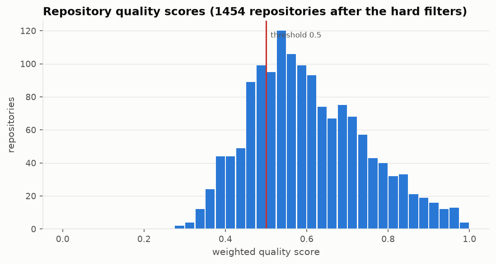
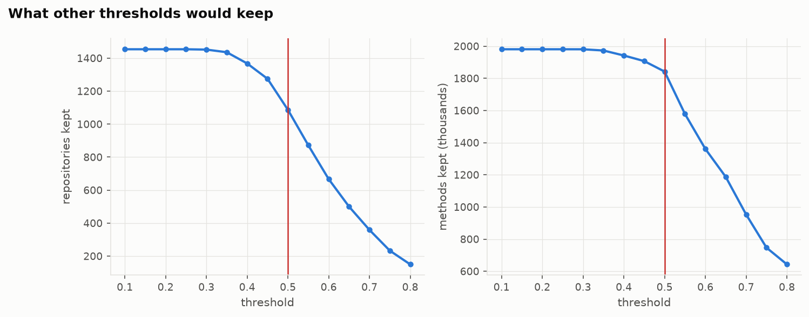
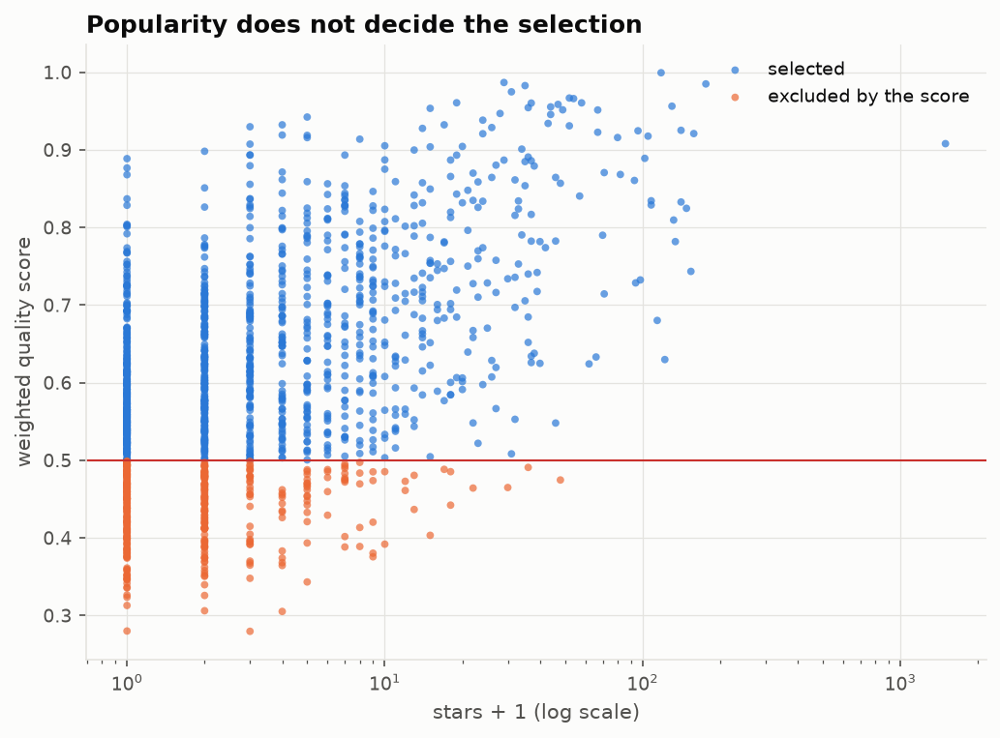
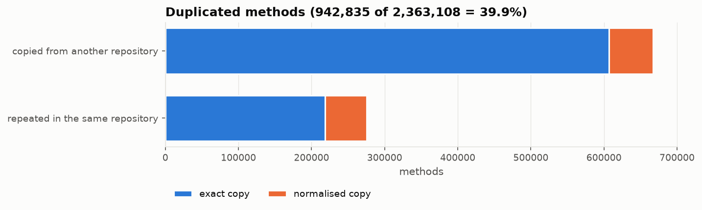
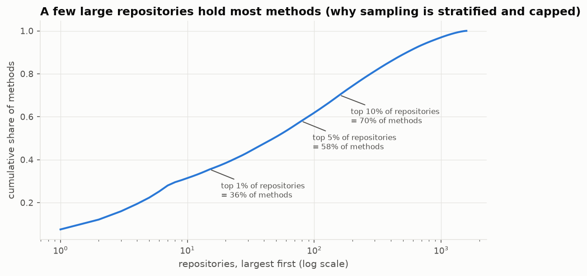
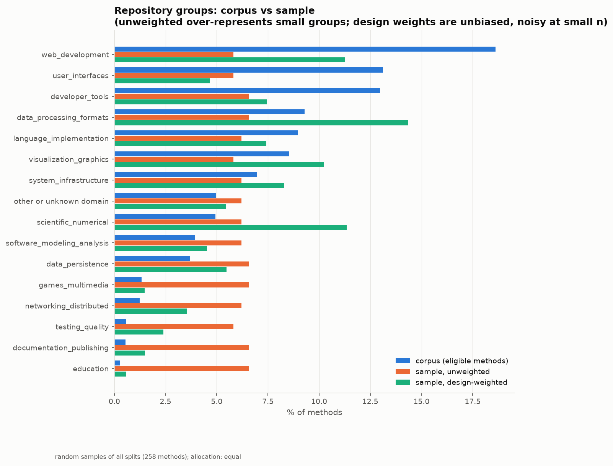
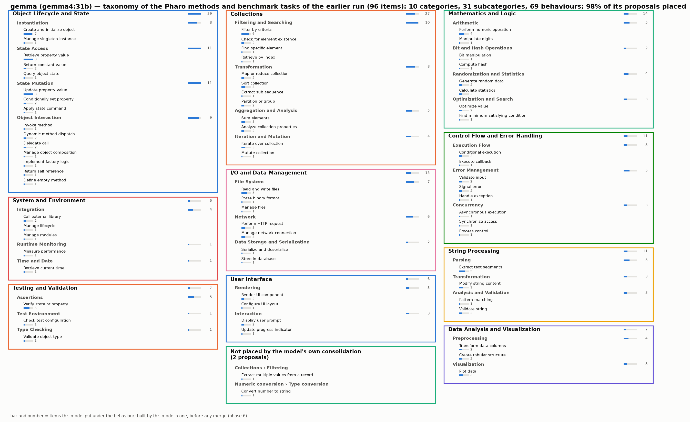
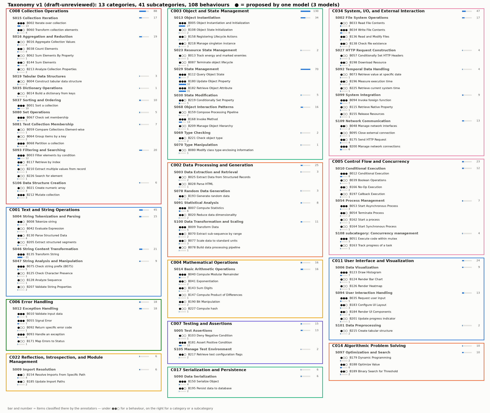

# How the pipeline works

From the Pharo repositories mined on GitHub to **two final taxonomies of programming behaviours**: one that
describes what real Pharo methods do, one that describes what the tasks of the existing code benchmarks ask for.
This document follows the data through every phase: what goes in, what happens and why, what comes out.


*Blue: the Pharo side. Orange: the existing benchmarks. The two sides are processed the same way and meet only at
the end, as two comparable taxonomies.*

---

## How to run it

```bash
./run.sh                  # setup, then phases 1–6; what is already done with the same inputs is skipped
./run.sh 5                # one phase       ./run.sh 3-6   a range       ./run.sh from 4   phases 4..6
./run.sh status           # where every phase stands       ./run.sh logs 5   the log of a phase
PROFILE=smoke ./run.sh    # the same pipeline on a few items, in results-smoke/ (a check that takes minutes)
```

Every phase writes into its own folder `results/NN_<phase>/`, with a `README.md`, its files and its `figures/`.
A phase resumes where it stopped (every model answer is cached), and is redone only when something it reads has
changed: its settings in `config.yaml`, the result of an earlier phase, or an expert file it imports.

---

## Step 0 — Setup: every dependency before anything runs

Before the first phase, `./run.sh` makes sure everything the phases need is there, and stops with the reason if
something cannot be obtained. When everything is present it takes a few seconds.

| What | How |
|---|---|
| The three annotator models, the editor model, the embedding model | pulled with Ollama, then checked to really load |
| The Pharo 13 image (with MuTalk and PharoBench-Support) and the list of its global names | built or copied into `data/pharo-image/` |
| The 12 benchmarks | downloaded at pinned revisions into `data/existing-benchmarks/` |
| The Pharo corpus (the parsed methods of every repository) | downloaded once from Hugging Face into `data/pharo-corpus/` |
| The Pharo PT model (used later, for evaluation) | its adapter merged into its base model and registered in Ollama |

---

## Phase 1 — Repository selection

**Goal.** Study engineered Pharo projects, not toy, personal or copied repositories.

**Input.** The 1,585 repositories of the corpus snapshot: they passed the first mining filter (real Pharo source
code, not coursework, some history). They are listed in `repos.txt`.

**What happens.**

1. **Hard filters**, which no score can compensate: GitHub forks; *mirrors*, whose non-trivial methods are mostly
   (≥ 50 %) copies of an older repository; repositories without any parsed method.
2. **A quality score** for each remaining repository: eleven criteria, each turned into a score between 0 and 1,
   then a weighted sum. This is the *reaper* way of recognising engineered projects (Munaiah et al. 2017).

   | criterion | what is measured | weight |
   |---|---|---|
   | community | contributors | 0.15 |
   | history | commits | 0.15 |
   | unit testing | share of test methods | 0.15 |
   | maintenance | how long it was developed × how recently | 0.10 |
   | documentation | share of classes with a class comment | 0.10 |
   | size | non-test methods | 0.10 |
   | originality | share of its code not copied from an older repository | 0.05 |
   | licence | a licence is declared | 0.05 |
   | issues | the issue tracker is used | 0.05 |
   | loadability | a Metacello `BaselineOf` (it can be loaded) | 0.05 |
   | popularity | stars and forks | 0.05 |

   Counts become scores with saturating curves (the 2,000th method adds almost nothing), so a giant repository
   cannot dominate. Popularity has a deliberately small weight: stars measure popularity, not quality (Borges &
   Valente 2018), and half of the Pharo repositories have none.
3. **The threshold**: a repository is selected when its score is at least **0.50**, half of the maximum.

**Output.** `selected_repos.txt` (≈ 1,087 repositories), `repository_scores.csv` (every measure, every criterion
score, the score, the decision and its reason), `scoring_scheme.md`.







*The score only decides which repositories are studied. It is never used later to make a repository count more.*

**Settings.** `config.yaml` → `repositories` (hard filters, weights, saturation points, threshold).

---

## Phase 2 — Literature ingestion

**Goal.** Know exactly what the existing benchmarks ask a model to do.

**Input.** The code benchmarks frontier models are evaluated on, at pinned revisions: HumanEval+, MBPP+,
BigCodeBench (Complete, Instruct), LiveCodeBench (code generation, test-output prediction, code execution),
SWE-bench Verified, Pro and Multilingual, Terminal-Bench 2.0, NL2Repo (DeepSWE when a Hugging Face token gives
access).

**What happens.** Every task is read and recorded with what the evaluated model receives, the reference answer,
how the answer is checked (tests), the programming language and the evaluation task type (code generation,
completion, bug repair, test generation, other). A problem that appears in several scenarios is counted once.

**Output.** `literature_tasks.parquet` (6,433 tasks = 4,372 distinct problems), `literature_benchmarks.csv`.

---

## Phase 3 — Corpus and method filters (decided on the syntax tree)

**Goal.** Keep the methods that carry real behaviour, and know why every other method is left out.

**Input.** Every method of the selected repositories (≈ 1.84 M), with its provenance (repository, commit, file,
line, link), its class, the definition of its class, and its **abstract syntax tree**.

**What happens.**

1. **Copies** are found across repositories, exactly and once comments and layout are removed. The oldest copy is
   the original.

   

2. **Each method gets a decision, decided on its syntax tree and on its class definition.** The names in a method
   are resolved like the Pharo compiler does: arguments and temporaries, then the variables of its class, then
   `self`, `super`, `true`, `false`, `nil`, then globals. A getter, for instance, is a method whose only statement
   returns one of its class's instance variables: not a method whose text looks like one.

   | method | decision |
   |---|---|
   | a copy of an older method · in a mirror repository · cannot be parsed | exclude |
   | simple getter `^ v` · simple setter `v := arg` (v a variable of its class) | exclude |
   | returns a constant (`^ 42`, `^ 'text'`, `^ true`, a literal array) | exclude |
   | empty · placeholder (`self subclassResponsibility`, `^ self`, `self error: 'not implemented'`) | exclude |
   | generated (package manifests, Metacello baselines, `<generated>`, embedded data) | exclude |
   | trivial `initialize` (`super initialize` and `v := literal` / `v := Class new` only) | exclude |
   | simple message forwarding · other initialisation · very long · uses classes neither its project nor Pharo defines | review: kept, marked with the reason |
   | test methods | kept separately |

**Output.** `methods.parquet`, `method_filters.parquet` (the decision and every reason of every method),
`method_filters_summary.csv`, figures.

**Settings.** `config.yaml` → `method_filters` (long-method limits, whether review methods are sampled).

---

## Phase 4 — Representative samples

**Goal.** Samples that really represent Pharo code and the benchmarks, large enough for 99 % confidence.

**Pharo methods.** A large repository must not dominate: a few projects hold most of the methods.



So the sample is **stratified by repository domain** and drawn in two stages: repositories first, then at most 4
methods per repository. Every method carries its design weight (how many methods of the corpus it stands for).



**Benchmarks.** Each benchmark contributes in proportion to its number of problems.

**How many.** The start sample gives **99 % confidence with a ±5 % margin** (Cochran's formula with the finite
population correction, p = 0.5): **663 Pharo methods** and **577 benchmark problems**. (100 % confidence would mean
taking every item — a census.) Targeted methods from rare areas (concurrency, FFI, reflection, network…) and test
methods (kept separately) are added.

**Representativeness check.** The 663 methods are compared with the whole population on what their syntax trees
show — loops, conditionals, iteration, exception handling, blocks, reflection, recursion, method size — each with
a 95 % interval; for the benchmarks, the share of every benchmark and task type.

**Output.** `sampling_design.json`, the samples, `representativeness.csv`, `representativeness_pharo.png`,
`representativeness_literature.png`. Each sample is an *ordered pool*: the start sample, then the items the
saturation loop of phase 5 will add, in order.

---

## Phase 5 — Discovery until saturation: three annotators, two sources

**Goal.** Find every behaviour that occurs, without imposing a list of categories in advance.

**Who.** Three instruction-tuned models of three different families — **qwen3.8:27b** (Alibaba), **gemma4:31b**
(Google), **mistral-small3.2:24b** (Mistral AI) — because related models make the same mistakes. Each works alone
and never sees another model's answers.

**What each annotator does, for each source (Pharo methods, then benchmark tasks).**

1. **Reads the 99 % start sample** and gives, for each item, up to three behaviours at three levels —
   **category › subcategory › behaviour** — in language-neutral words, with a quote of the item as evidence.
2. **Saturation loop.** It goes on with rounds of 50 new items from the same pool. After each round, its proposals
   are compared with everything it proposed before (embeddings): a group of similar proposals that reaches 2 items
   is a behaviour; a round is *new* if a behaviour appears.
3. **Stops at saturation**: when **19 rounds in a row bring no new behaviour**. At that point, a behaviour present in
   0.5 % of the items would have appeared with 99 % probability.
4. **Consolidates** everything it proposed into its own taxonomy, with a definition for every concept and rules
   saying when to use a behaviour and when not to.

**Output: six taxonomies**, each in `05_discovery/<annotator>/<pharo|literature>/`: the figure `taxonomy.png`,
`taxonomy.json`, `taxonomy.csv` (one row per behaviour), `items.csv` (every item with the category, subcategory and
behaviour this annotator gave it), the saturation curve (`saturation.png`, `saturation.csv`).

An annotator's taxonomy, as it is drawn (here, from the earlier run):



---

## Phase 6 — The two final taxonomies

**Goal.** One taxonomy per source that the three annotators support, with stable identifiers.

**What happens, for the Pharo methods and, separately, for the benchmark tasks.**

1. **How similar two concepts are**, for each level (category, subcategory, behaviour) — two pieces of evidence:
   - **their meaning**: the embeddings of their texts ("name: definition"), compared by cosine;
   - **their items**: the three annotators classified the *same* items, so two concepts that hold the same items
     very likely mean the same thing, even with different words, and two concepts with similar words but different
     items very likely do not. The overlap (Jaccard) is measured on the items both annotators saw; for a category or a
     subcategory, its items are every item under it.

   **similarity = 0.6 × embedding cosine + 0.4 × item overlap.** Concepts are grouped by this similarity
   (average-linkage clustering). The groups are only *candidates*.
2. **Judged merges.** An editor model reads each candidate group — every member with the number of items it holds,
   the largest first — and keeps together only the concepts that mean the same thing, naming them after the
   members that hold most items. Groups it splits are listed for the experts.
3. **One tree, weighted by items.** A behaviour goes under the subcategory where most of its members' *items* were
   placed (not most of its members), a subcategory under the category where most of its items were; categories are
   then merged down to at most 16 (the editor sees how many items each holds), duplicates merged. Every operation is
   recorded.
4. **Stable identifiers** (`C001` categories, `S001` subcategories, `B001` behaviours), kept across reruns; each
   concept keeps its definition, its rules, its aliases (the annotators' wordings), the annotators that proposed it
   and the items classified under it.
5. **Expert review.** `review/taxonomy_review.xlsx` lets an expert accept, rename, redefine, merge, split, reject,
   add or move any concept; the completed file in `review/returned/` gives the reviewed taxonomy at the next run.

**Output.** `06_taxonomy/pharo/taxonomy_v1.json` and `06_taxonomy/literature/taxonomy_v1.json`, with their figures,
aliases, merge candidates, annotation guidelines and review workbooks.

### How to read a taxonomy figure



*(The earlier run, drawn the way every taxonomy is drawn now. In that run the item lists were not yet kept, so the
category and subcategory counts here are sums; a new run counts distinct items.)*

- **A box** is a category; **grey bold** lines are its subcategories; the other lines are its behaviours, with their
  identifier.
- **●●○** before a behaviour: one ● for each annotator whose concept was merged into it by the embedding + item
  merge of this phase (●●● = the three annotators found this behaviour).
- **Under the ●●○**, a thin bar and a number: **how many items were classified under that behaviour**.
- **On the right of a category or subcategory**, the same bar and number: how many items were classified anywhere
  inside it.
- The bars are scaled per level, so the largest category, subcategory and behaviour have a full bar.

---

## What comes next (stage 2)

With the two final taxonomies, the next stage compares them and builds the benchmark: classify NEW samples with
each taxonomy (its validation), measure agreement between annotators and with experts, estimate how often each
behaviour occurs in Pharo, map the two taxonomies onto each other (what Pharo does that benchmarks do not test, and
the reverse), then write, verify and evaluate executable Pharo tasks. That code (phases 7–13) exists but still
expects a single shared taxonomy; `./run.sh` stops after phase 6.

## Where everything is

```
results/
  SUMMARY.md                                       every phase: status, key numbers, figures
  logs/                                            the logs of every phase, readable
  01_repositories/                                 repos.txt, repository_scores.csv, selected_repos.txt
  02_literature/                                   the benchmark tasks
  03_corpus/                                       the methods and the decision on each
  04_sampling/                                     the samples and their representativeness
  05_discovery/<annotator>/<pharo|literature>/     the six annotators' taxonomies
  06_taxonomy/<pharo|literature>/                  the two final taxonomies
data/                                              downloads, Pharo image, model cache (not in git)
config.yaml                                        every setting
```
